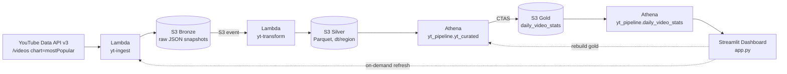

# YouTube Trending Analytics Pipeline

!


An end-to-end, event-driven, serverless data pipeline that ingests YouTube trending metrics across regions, curates partitioned Parquet datasets on S3, models daily gold aggregates in Athena, and serves an interactive Streamlit dashboard for run-vs-run and category-level analysis.

> **Highlights:** medallion architecture (bronze/silver/gold) · fully provisioned with Terraform · idempotent gold rebuilds · built-in data quality monitoring · on-demand ingestion from the UI

---

## Table of Contents

- [Architecture](#architecture)
- [Tech Stack](#tech-stack)
- [Data Layers](#data-layers)
- [Key Features](#key-features)
- [Data Quality Checks](#data-quality-checks)
- [Project Structure](#project-structure)
- [Getting Started](#getting-started)
- [Configuration](#configuration)
- [Usage](#usage)
- [Design Decisions](#design-decisions)
- [Troubleshooting](#troubleshooting)
- [Roadmap](#roadmap)
- [Documentation](#documentation)
- [Author](#author)

---

## Architecture



<details>
<summary>ASCII version</summary>

```text
+-------------------+      +---------------------+      +-------------------------+
|  YouTube Data API | ---> |   AWS Lambda        | ---> |   Amazon S3 (Raw)       |
|  (v3 /videos)     |      |   (yt-ingest)       |      |   JSON Snapshots        |
+-------------------+      +---------------------+      +-------------------------+
                                                                     |
                                                          S3 Event / Trigger
                                                                     v
+-------------------+      +---------------------+      +-------------------------+
|  Streamlit UI     | <--- |   AWS Athena        | <--- |   AWS Lambda            |
|  (app.py)         |      |   yt_pipeline DB    |      |   (yt-transform)        |
+-------------------+      +---------------------+      +-------------------------+
        |                            ^                               |
        |  On-Demand Refresh         |  Partitioned Parquet          v
        +----------------------------+------------------- Amazon S3 (Curated & Gold)
```
</details>

---

## Tech Stack

| Layer | Technology |
|---|---|
| Ingestion | AWS Lambda (Python), YouTube Data API v3 |
| Storage | Amazon S3 (JSON raw, partitioned Parquet) |
| Catalog & Query | AWS Glue Data Catalog, Amazon Athena |
| Transformation | Lambda (event-driven), Athena CTAS |
| Infrastructure | Terraform |
| Dashboard | Streamlit, Plotly, pandas, AWS SDK for pandas (`awswrangler`), boto3 |

---

## Data Layers

| Layer | Location | Description |
|---|---|---|
| **Bronze** (raw) | S3 | Raw JSON payloads captured per region (IN, GB, US, ...) by `yt-ingest`. Immutable snapshots. |
| **Silver** (curated) | `yt_pipeline.yt_curated` | Cleaned, deduplicated, schema-enforced Parquet, partitioned by `dt` and `region`. |
| **Gold** (analytics) | `yt_pipeline.daily_video_stats` | Daily video-level rollups built via Athena CTAS ([`sql/11_create_daily_stats.sql`](sql/11_create_daily_stats.sql)). |

**Gold table metrics:** end-of-day views, likes, comments · best daily rank · intra-day view delta · snapshot count.

---

## Key Features

- **Serverless, event-driven pipeline:** `yt-ingest` and `yt-transform` Lambdas chained through S3 events, all provisioned with Terraform (`infra/`).
- **Idempotent gold rebuilds:** `MSCK REPAIR TABLE` → single-statement `DROP` → S3 prefix cleanup → `CTAS`, with explicit Athena execution-status verification at each step. Safe to re-run any time.
- **Run-vs-run comparison:** compare any two pipeline runs side by side by category, country/region, and view metrics using Plotly charts.
- **On-demand refresh:** trigger a fresh ingest and gold rebuild straight from the dashboard.
- **Built-in data quality monitoring:** live Athena checks surfaced in the UI (see below).
- **Cost-aware design:** columnar Parquet + partition pruning on `dt` and `region` keeps Athena scans small.

---

## Data Quality Checks

The dashboard runs these against Athena on demand:

| Check | What it catches |
|---|---|
| Row count | Empty or truncated loads |
| Distinct video IDs | Unexpected drops in coverage |
| Duplicate video-days | Broken dedup or double ingestion |
| Null video IDs | Malformed API payloads |
| Negative view deltas | Counter resets / bad snapshots |
| Rank validity | Ranks outside the expected range |

---

## Project Structure

```text
.
├── infra/                  # Terraform: S3, IAM, Lambda, Glue/Athena
├── sql/
│   └── 11_create_daily_stats.sql   # CTAS for yt_pipeline.daily_video_stats
├── src/
│   ├── dashboard/
│   │   └── app.py          # Streamlit dashboard + Athena refresh orchestrator
│   └── lambdas/            # yt-ingest and yt-transform handlers
├── YouTube_Streaming_Data_Engineering_Project_Documentation.pdf
├── .env.example
└── README.md
```

---

## Getting Started

### Prerequisites

- Python **3.11+**
- Terraform **1.5+**
- AWS account with access to S3, Lambda, Glue Data Catalog, and Athena (`ap-south-1`)
- AWS CLI configured (`aws configure` or a named profile)
- YouTube Data API v3 key

### 1. Clone and install

```bash
git clone https://github.com/Shrey1029/Yt-streaming-pipeline.git
cd Yt-streaming-pipeline

python -m venv .venv

# Windows
.venv\Scripts\activate
# macOS / Linux
source .venv/bin/activate

pip install streamlit boto3 awswrangler pandas plotly python-dotenv
```

### 2. Deploy the infrastructure

```bash
cd infra
terraform init
terraform plan
terraform apply
cd ..
```

Set your YouTube API key in the `yt-ingest` Lambda environment variables (or via a Terraform variable) before the first run.

### 3. Configure the dashboard

```bash
cp .env.example .env
```

Then edit `.env` (see [Configuration](#configuration)).

### 4. Run

```bash
streamlit run src/dashboard/app.py
```

Open http://localhost:8501.

---

## Configuration

| Variable | Description | Example |
|---|---|---|
| `AWS_DEFAULT_REGION` | AWS region for all services | `ap-south-1` |
| `AWS_PROFILE` | Named AWS profile (**recommended** over static keys) | `default` |
| `AWS_ACCESS_KEY_ID` / `AWS_SECRET_ACCESS_KEY` | Static credentials (only if not using a profile) | n/a |
| `YT_INGEST_LAMBDA` | Name of the ingestion Lambda | `yt-ingest` |
| `ATHENA_OUTPUT_BUCKET` | S3 bucket for Athena query results | `your-athena-results-bucket` |
| `GOLD_STATS_S3_LOCATION` | Fixed S3 prefix for the gold table | `s3://your-pipeline-bucket/gold/daily_video_stats/` |

> **Why `GOLD_STATS_S3_LOCATION`?** It gives Athena a deterministic location for `daily_video_stats`, which is wiped before each CTAS rebuild. This prevents `HIVE_PATH_ALREADY_EXISTS` and leftover-object errors.

> **Security:** never commit `.env`. Use an IAM user/role scoped to the pipeline's resources only (S3 prefix, `lambda:InvokeFunction` on `yt-ingest`, Athena and Glue access).

---

## Usage

1. **Refresh data:** use the dashboard's refresh action to invoke `yt-ingest` and rebuild the gold table.
2. **Explore trends:** view category and region shifts over time.
3. **Compare runs:** pick two runs and compare views by category and country.
4. **Audit quality:** open the data quality panel to run the Athena checks.

---

## Design Decisions

- **Parquet + partitioning (`dt`, `region`):** lower Athena scan cost and faster queries than raw JSON.
- **CTAS for gold instead of a long-running job:** keeps the stack serverless and the logic in plain, reviewable SQL.
- **Drop-and-rebuild gold:** simple, idempotent, and easy to reason about at this data volume; incremental inserts are a future option.
- **Terraform for everything:** reproducible environments, easy teardown to avoid idle cost.

---

## Troubleshooting

| Symptom | Fix |
|---|---|
| `HIVE_PATH_ALREADY_EXISTS` on CTAS | Set `GOLD_STATS_S3_LOCATION`; the rebuild clears that prefix first. |
| New partitions not visible in Athena | Run `MSCK REPAIR TABLE yt_pipeline.yt_curated`. |
| `AccessDenied` from Athena | Check IAM for S3 access to both the data and the results bucket. |
| YouTube `quotaExceeded` | The Data API has a daily quota; reduce regions or ingest frequency. |
| Empty dashboard | Confirm `yt-ingest` ran and `yt-transform` wrote Parquet to the curated prefix. |

More detail is in the project documentation PDF.

---

## Roadmap

- [ ] Scheduled ingestion via EventBridge
- [ ] Incremental gold updates instead of full rebuilds
- [ ] CI with `terraform validate` and linting (GitHub Actions)
- [ ] Unit tests for Lambda handlers
- [ ] Alerting on failed DQ checks (SNS)
- [ ] Dashboard screenshots / live demo

---

## Documentation

Full system design, troubleshooting, and architecture flowcharts: [`YouTube_Streaming_Data_Engineering_Project_Documentation.pdf`](YouTube_Streaming_Data_Engineering_Project_Documentation.pdf)

---

## Author

**Shreyansh** · [GitHub](https://github.com/Shrey1029)
